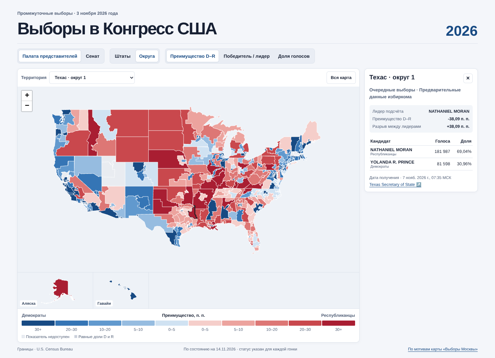

# Выборы в Конгресс США · 2026

Интерактивная карта результатов промежуточных выборов в Палату представителей и Конгресс США, которые прошли 3 ноября 2026 года.

[Открыть карту на GitHub Pages](https://terracodingzavr.github.io/US-Elections-2026-Webmap/).

## Как читать карту

Основная картограмма показывает разницу долей демократов и республиканцев в процентных пунктах. Выбор территории осуществляется на карте или в списке,при выборе открывается круговая диаграмма,таблица голосов, статус и ссылку на источник. Аляска и Гавайи отображаются в картах-врезках. Зум картографического изображения осуществляется исключительно кнопками «+» и «-» по причине лени картографа, который создал карту

Не все результаты окончательные, в некоторых штатах досчитывают голоса. Для 294 кампаний Палаты и 21 кампании Сената использованы публикации избиркомов. Для остальных 142 и 14 соответственно использованы подсчёты агрегаторов. При неполном или несопоставимом наборе данных штат может не иметь рассчитанного преимущества одной из партий/кандидатов.

## Могут ли в карте быть ошибки?

Безусловно.
